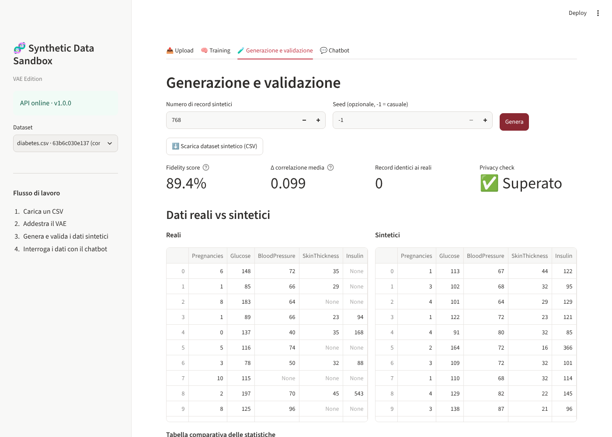
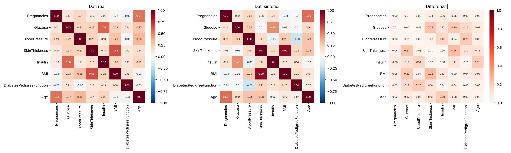
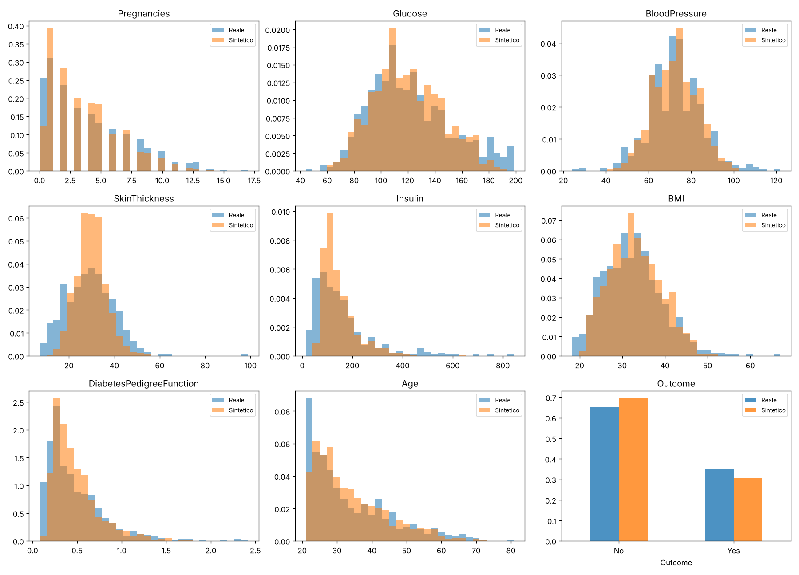
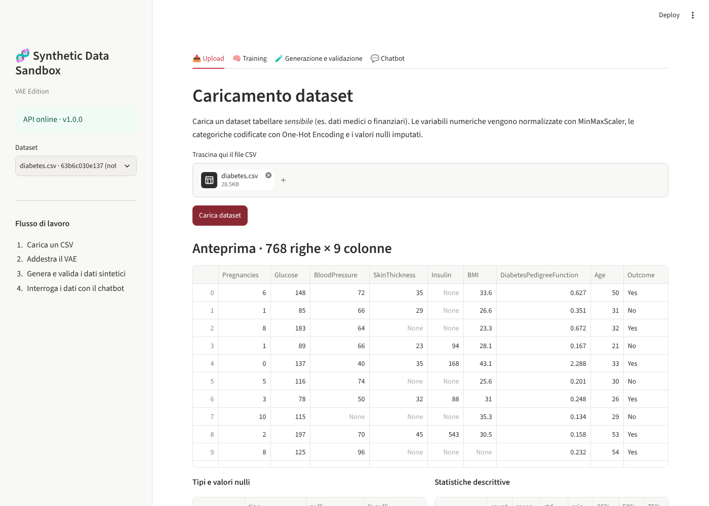
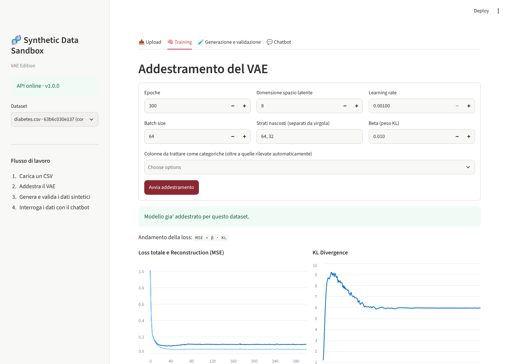

# Synthetic Data Sandbox (VAE Edition)

Progetto finale del **Modulo 6 – Generative AI** del master Epicode.

Piattaforma in cui un utente carica un dataset tabellare "sensibile" (dati medici o finanziari),
addestra un **Variational Autoencoder** per impararne la distribuzione latente e genera un
**dataset sintetico anonimo** che mantiene le proprietà statistiche dell'originale.
I dati sintetici si possono poi interrogare in linguaggio naturale tramite un LLM.



---

## Architettura

```
┌────────────────────┐   HTTP    ┌──────────────────────────┐
│  Streamlit UI      │ ───────▶ │  FastAPI backend          │
│  app/              │ ◀─────── │  api/main.py              │
└────────────────────┘           └────────────┬─────────────┘
                                              │
            ┌─────────────────────────────────┼──────────────────────────────┐
            ▼                                 ▼                              ▼
  Data Engine                        Generative Core                 Natural Language Analyst
  data_engine.py                     vae.py + trainer.py             llm_analyst.py + safe_exec.py
  MinMax / One-Hot / nulli           Encoder → z → Decoder           OpenAI → codice → sandbox
                                              │
                                              ▼
                                     Validazione (validation.py)
                                     correlazioni · distribuzioni · privacy
```

| Componente | File | Descrizione |
|---|---|---|
| **Data Engine** | `src/sandbox/data_engine.py` | Rilevamento tipi, imputazione nulli, MinMaxScaler, One-Hot Encoding, trasformazione inversa |
| **Generative Core** | `src/sandbox/vae.py`, `src/sandbox/trainer.py` | VAE fully connected in PyTorch, reparameterization trick, loss MSE + KL, training/salvataggio |
| **Validazione** | `src/sandbox/validation.py` | Heatmap correlazioni, istogrammi, test KS / TVD, privacy check (copie esatte e DCR) |
| **LLM Analyst** | `src/sandbox/llm_analyst.py`, `src/sandbox/safe_exec.py` | System prompt con schema del dataset, generazione codice Pandas/Matplotlib, esecuzione sicura |
| **Analytic Backend** | `api/main.py` | API FastAPI: `/upload`, `/train`, `/generate`, `/validate`, `/ask` |
| **User Interface** | `app/streamlit_app.py` | Dashboard Streamlit con upload drag-and-drop, training, confronto reali/sintetici, chatbot |

```
.
├── api/main.py                  # FastAPI
├── app/streamlit_app.py         # Streamlit
├── src/sandbox/                 # logica del progetto
├── scripts/
│   ├── prepare_dataset.py       # pulizia del dataset Pima
│   └── train_cli.py             # training + report da riga di comando
├── data/
│   ├── raw/                     # CSV originale scaricato
│   ├── diabetes.csv             # dataset preparato
│   └── synthetic_diabetes.csv   # esempio di output
├── reports/                     # metriche e grafici dell'esperimento
└── tests/                       # test pytest
```

---

## Installazione

```bash
python -m venv .venv
source .venv/bin/activate          # su Windows: .venv\Scripts\activate
pip install -r requirements.txt
cp .env.example .env               # e inserire la propria OPENAI_API_KEY
```

## Avvio

In due terminali separati:

```bash
# 1. backend
uvicorn api.main:app --reload --port 8000

# 2. interfaccia
streamlit run app/streamlit_app.py
```

- UI: http://localhost:8501
- Documentazione Swagger dell'API: http://localhost:8000/docs

In alternativa, tutto da riga di comando (senza API e senza UI):

```bash
python scripts/train_cli.py data/diabetes.csv --epochs 300 --out data/synthetic_diabetes.csv --report reports
```

## Test

```bash
pytest
```

I test coprono preprocessing (incluso il round-trip `transform` → `inverse_transform`), il VAE,
le metriche di validazione, la sandbox di esecuzione del codice, l'analyst LLM (con un client
OpenAI finto) e l'intero flusso dell'API.

---

## Fase 1 – Data Preparation

**Dataset:** [Pima Indians Diabetes](https://www.kaggle.com/datasets/uciml/pima-indians-diabetes-database)
(768 pazienti, 8 variabili cliniche + esito del diabete).

Il CSV originale (`data/raw/`) non ha intestazione e usa `0` per indicare valori non rilevati in
`Glucose`, `BloodPressure`, `SkinThickness`, `Insulin` e `BMI`. Lo script
`scripts/prepare_dataset.py` aggiunge i nomi delle colonne, converte questi zeri in `NaN`
(ad esempio quasi metà dei valori di `Insulin` è mancante) e trasforma `Outcome` in una
variabile categorica `Yes`/`No`.

Il `DataPreprocessor` è generico e funziona con qualsiasi CSV:

- **tipi**: le colonne non numeriche, booleane o con al massimo 2 valori distinti sono trattate come categoriche (si può forzare la scelta dalla UI);
- **valori nulli**: mediana per le numeriche, moda per le categoriche;
- **numeriche**: `MinMaxScaler` → intervallo [0, 1];
- **categoriche**: `OneHotEncoder`;
- **inversa**: clipping in [0, 1], `inverse_transform` dello scaler, arrotondamento delle colonne intere e `argmax` sui blocchi one-hot per ricostruire la categoria.

## Fase 2 – Il cuore generativo: VAE

```
x (d) ─▶ Linear 64 ─ BN ─ LeakyReLU ─▶ Linear 32 ─ BN ─ LeakyReLU ─┬▶ μ (8)
                                                                    └▶ log σ² (8)
z = μ + σ · ε,   ε ~ N(0, I)                    (reparameterization trick)
z (8) ─▶ Linear 32 ─ BN ─ LeakyReLU ─▶ Linear 64 ─ BN ─ LeakyReLU ─▶ Linear d ─▶ Sigmoid ─▶ x̂
```

- **Encoder**: comprime il vettore in media e log-varianza dello spazio latente.
- **Reparameterization trick**: `z = μ + exp(0.5·logvar) · ε` rende il campionamento differenziabile.
- **Decoder**: ricostruisce il vettore; la sigmoid in uscita è coerente con i dati in [0, 1].
- **Loss**: `MSE(x̂, x) + β · KL(q(z|x) ‖ N(0, I))`, entrambe sommate sulle feature e mediate sul batch.

Dettagli di training: Adam (lr 1e-3), `ReduceLROnPlateau`, 300 epoche, batch 64 e
*KL annealing* (il peso della KL cresce linearmente nel primo quarto delle epoche).

### Scelta di β

Con β = 1 il modello andava in **posterior collapse**: siccome tutte le feature sono in [0, 1], la
MSE è molto piccola e la KL domina la loss, per cui il decoder impara a produrre quasi sempre la
media. Nel primo esperimento la deviazione standard sintetica di `Glucose` era 7.6 contro 30.5
dei dati reali. Ho quindi fatto una ricerca su β e sulla dimensione latente:

| β | latent | Fidelity | Δ corr. media | std Glucose (reale 30.5) | Privacy |
|---|---|---|---|---|---|
| 1.0  | 8  | 0.619 | 0.375 | 7.6  | ✗ |
| 0.1  | 8  | 0.727 | 0.372 | 14.9 | ✗ |
| 0.05 | 8  | 0.785 | 0.192 | 17.7 | ✗ |
| 0.02 | 8  | 0.871 | 0.123 | 24.3 | ✗ |
| **0.01** | **8** | **0.897** | **0.097** | **26.0** | **✓** |
| 0.005 | 8 | 0.915 | 0.092 | 26.0 | ✓ |
| 0.005 | 16 | 0.893 | 0.063 | 26.0 | ✓ |

Ho scelto **β = 0.01** come default: è il punto in cui le distribuzioni diventano fedeli senza
spingere troppo verso la memorizzazione dei record. Abbassando ancora β il VAE si comporta
sempre più come un autoencoder classico e lo spazio latente si allontana dalla N(0, I) da cui
si campiona in generazione. Tutti i parametri sono modificabili dalla UI.

## Fase 3 – Generazione e validazione

**Sampling:** dopo il training l'encoder non serve più. Si campionano vettori `z ~ N(0, I)`, si
passano al decoder e l'output viene riportato nello spazio originale dal `DataPreprocessor`.

Risultati sull'esperimento di riferimento (`reports/`, 768 record sintetici):

| Metrica | Valore |
|---|---|
| Fidelity score (media di 1−KS e 1−TVD) | **0.899** |
| Differenza media tra le matrici di correlazione | **0.085** |
| Record sintetici identici a quelli reali | **0** |
| Sintetici più vicini a un reale del 5° percentile reale-reale | 6.5 % |
| Privacy check | **superato** |

**Correlazione** – heatmap delle matrici reale, sintetica e della differenza assoluta:



**Distribuzione** – istogrammi sovrapposti per ogni variabile:



**Privacy check** – oltre a cercare copie esatte calcolo la *Distance to Closest Record* (DCR):
per ogni record sintetico la distanza dal record reale più vicino, nello spazio normalizzato.
Come riferimento uso la distanza tra ogni record reale e il suo vicino reale più prossimo: se una
quota rilevante dei sintetici è più vicina ai reali di quanto lo sia il 5% dei reali tra loro, il
modello sta probabilmente copiando (overfitting). Il check è superato se non ci sono copie
esatte e questa quota è sotto il 10%.

**Limiti osservati:** il VAE tende ad attenuare le code delle distribuzioni (massimi di
`Insulin` e `SkinThickness` più bassi del reale) e il picco di `SkinThickness` è più marcato,
perché i molti valori mancanti sono stati imputati con la mediana. È un effetto noto dei VAE
con loss MSE, che regolarizzano verso valori medi.

## Fase 4 – Natural Language Analyst

1. **Setup**: client OpenAI (`OPENAI_API_KEY` e `OPENAI_MODEL` nel file `.env`).
2. **Prompt engineering**: il system prompt viene costruito dinamicamente con nome, tipo e
   categorie di ogni colonna, statistiche descrittive e prime righe del dataset sintetico, più
   le regole sul codice (solo `df`, pandas, numpy, matplotlib/seaborn, niente file o rete,
   risultato in `result`).
3. **Funzionamento**: l'utente chiede ad esempio *"Qual è la correlazione tra glucosio e BMI?"*;
   l'LLM risponde con una spiegazione e un blocco di codice Python che il backend estrae ed esegue.
   Se il codice va in errore, l'errore viene rimandato al modello che ha un tentativo per
   correggersi. La UI mostra spiegazione, grafici, risultato e codice generato.

### Esecuzione sicura del codice

Il codice generato da un LLM non è affidabile, quindi `safe_exec.py` usa più livelli di difesa:

- **analisi statica con `ast`**: import solo da una whitelist (pandas, numpy, matplotlib,
  seaborn, scipy, math, statistics), vietati attributi privati/dunder, `eval`, `exec`, `open`,
  `getattr`, metodi pandas/numpy che leggono o scrivono file, cicli `while`;
- **builtins ridotti** e `__import__` filtrato durante l'esecuzione;
- **processo separato** con timeout (20 s) e limite di CPU: un loop o un crash non bloccano l'API;
- il codice lavora su una **copia** del DataFrame; i grafici vengono catturati come PNG.

## Fase 5 – API e UI

### Endpoint FastAPI

| Metodo | Endpoint | Descrizione |
|---|---|---|
| `POST` | `/upload` | Carica un CSV, restituisce `dataset_id`, tipi, nulli e anteprima |
| `POST` | `/train` | Avvia in background l'addestramento del VAE (iperparametri nel body) |
| `GET`  | `/train/{dataset_id}/status` | Stato del training, epoca corrente e storico della loss |
| `GET`  | `/generate?dataset_id=…&n_samples=…&seed=…` | Genera e scarica il dataset sintetico in CSV |
| `POST` | `/validate` | Metriche di correlazione, distribuzione, privacy e tabella comparativa |
| `POST` | `/ask` | Domanda in linguaggio naturale sui dati sintetici |
| `GET`  | `/datasets`, `/datasets/{id}`, `/datasets/{id}/data` | Elenco, dettagli e contenuto dei dataset |
| `GET`  | `/health` | Stato del servizio |

Esempio con `curl`:

```bash
ID=$(curl -s -F "file=@data/diabetes.csv" localhost:8000/upload | python -c "import sys,json;print(json.load(sys.stdin)['dataset_id'])")
curl -s -X POST localhost:8000/train -H "Content-Type: application/json" -d "{\"dataset_id\": \"$ID\", \"epochs\": 300}"
curl -s localhost:8000/train/$ID/status          # attendere "completed"
curl -s "localhost:8000/generate?dataset_id=$ID&n_samples=1000" -o synthetic.csv
```

### Interfaccia Streamlit

- **Upload**: drag-and-drop del CSV, anteprima, tipi, valori nulli e statistiche.
- **Training**: iperparametri del VAE, barra di avanzamento e curve della loss in tempo reale.
- **Generazione e validazione**: generazione e download del CSV, metriche principali, tabella
  comparativa reali vs sintetici, heatmap delle correlazioni, istogrammi e privacy check.
- **Chatbot**: chat con il Natural Language Analyst sui dati sintetici.

| Upload | Training |
|---|---|
|  |  |

---

## Possibili sviluppi

- loss specifiche per tipo di variabile (cross-entropy sulle categoriche invece della MSE);
- trasformazioni per le distribuzioni asimmetriche (es. log o quantile transform su `Insulin`) per migliorare le code;
- confronto con altri generatori tabellari (CTGAN, TVAE);
- privacy differenziale durante il training (DP-SGD) per garanzie formali di anonimato;
- metrica di utilità "train on synthetic, test on real" con un classificatore sull'`Outcome`.
